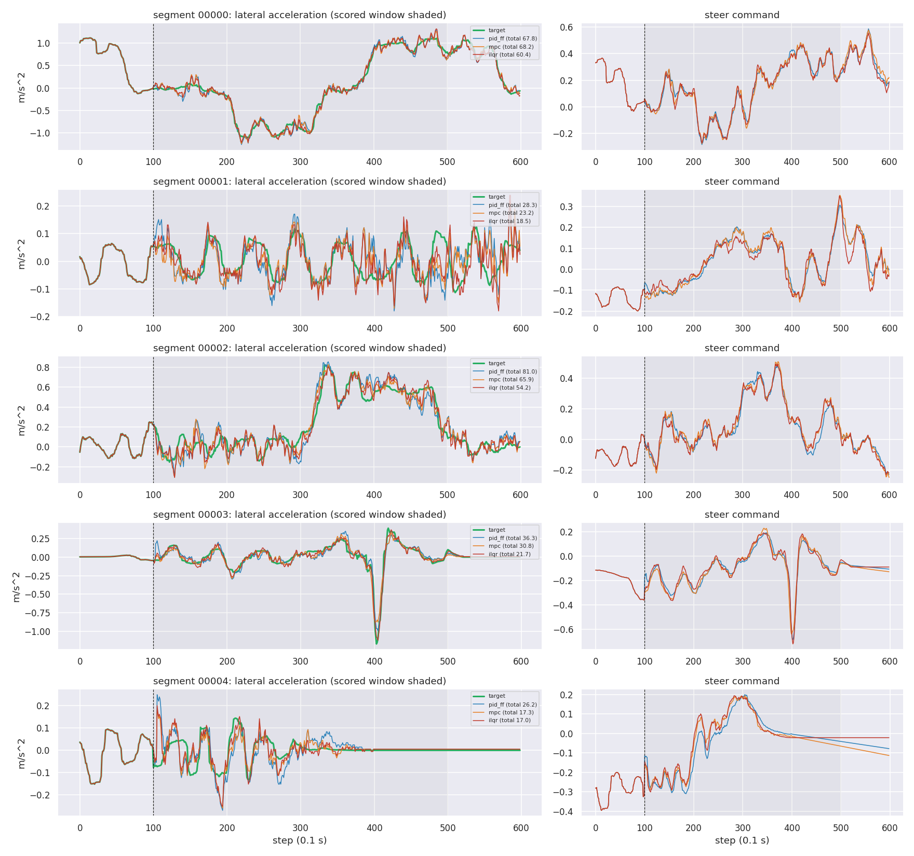

# Optimal control for the comma Controls Challenge v2 (honest track)

Steering controllers for [commaai/controls_challenge](https://github.com/commaai/controls_challenge)
built with optimal control: system identification, a Kalman disturbance observer,
preview MPC (OSQP and a hand-written TinyMPC-style ADMM), and receding-horizon iLQR
through the simulator's own model. Every controller is causal and uses only what
`update()` receives. All numbers below come from saved runs in `results/`.

## Headline (test set = official 5000 segments, 00000-04999)

| controller | total cost |
|---|---:|
| PID (upstream baseline) | 110.25 |
| PID + preview feedforward, 7 parameters tuned once (Nelder-Mead) | 63.64 |
| PID + preview feedforward, 10 parameters tuned once (CMA-ES): the strong baseline | 60.42 |
| Preview MPC on an identified ARX model + Kalman disturbance observer (OSQP or ADMM) | 57.44 / 57.40 |
| Receding-horizon iLQR through the TinyPhysics model (expected value) | **40.59** (official eval.py: 40.54) |

The linear MPC beats our strongest PID+FF (60.4) but not the best PID+FF on the leaderboard (50.6). The
iLQR beats the ~48 of the best feedback-style entries, but it uses the simulator's own
network as its model (see "Leaderboard context"). Its first test run scored **58.19**
because of two saturation blow-ups. The fix was designed on non-test data, and only 7 of the
5000 test segments changed (see "The iLQR blow-ups").

## Honesty rules

These are deliberate constraints. The top of the leaderboard (6.88, "per segment direct
quadratic optimization") breaks them; we do not.

1. The controller uses only what `update()` receives each step: `target_lataccel`,
   `current_lataccel`, `state` (roll, v_ego, a_ego) and `future_plan`, plus its own memory
   of past inputs and outputs.
2. Never touch the RNG or seed. Controllers never call numpy's global RNG; the
   simulator's noise is exactly the official noise.
3. Never read the data file from a controller.
4. Never tune per segment. Every gain is global, chosen once.
5. Never compute the offline optimum of the score.

Additional rules we followed so the numbers mean what they say:

- **Train / dev / test split.** Tuning used dev segments 10000-10199 (reported dev
  numbers on 10000-10499). System identification used 15000-15399. The test set
  00000-04999 was only used for final numbers, never for choices, with one exception: the
  iLQR's saturation search was added after its first test run (see "The iLQR blow-ups").
- **What the controller knows about the simulator interface.** It counts its own
  `update()` calls, so it knows that its output is ignored before step 100
  (`CONTROL_START_IDX`). A car controller likewise knows when it is engaged. During those
  warmup steps the simulator applies the logged steer, which the controller never sees;
  the model-based controllers store a guess of it from a static inverse model fitted
  offline on non-test data (`steer ~ 0.55*target(t+2) - 0.6*roll(t+2)`).
- **Model knowledge.** The MPC uses a small ARX model identified offline. The iLQR uses
  the simulator's transformer itself (expected value of its output distribution, never a
  sample) as its internal model. That is "model-in-the-loop" control: legitimate under the
  rules above, but it means the iLQR has a perfect mean model, which a real car would not.
  It should be compared with the leaderboard's other model-based MPC entries (see below).

## How to run

```bash
uv venv --python 3.11 .venv
uv pip install --python .venv/bin/python -r requirements-project.txt   # torch: see the file
# dataset: running tinyphysics.py once downloads it into data/ (00000.csv ... 19999.csv)

# official harness, one process per segment (unmodified tinyphysics.py)
.venv/bin/python scripts/run_eval.py --controller mpc --num_segs 5000
.venv/bin/python eval.py --model_path ./models/tinyphysics.onnx --data_path ./data --num_segs 5000 \
    --test_controller mpc --baseline_controller pid

# iLQR in the official eval.py (CPU, ~1 min per segment per worker). Hide the GPU: eval.py runs
# sample rollouts in the parent and then forks, and PyTorch's autograd refuses to run in a
# forked child once its CUDA device threads exist.
CUDA_VISIBLE_DEVICES= .venv/bin/python eval.py --model_path ./models/tinyphysics.onnx --data_path ./data \
    --num_segs 5000 --test_controller ilqr --baseline_controller pid

# iLQR on the GPU through the lockstep evaluator (exactness check: scripts/verify_batch_eval.py)
.venv/bin/python scripts/run_batch_eval.py --start 0 --num_segs 5000 --H 12 --iters 1 --w_du 2.0 \
    --shifts -0.3 -0.1 0.1 0.3 --name ilqr

.venv/bin/python scripts/make_table.py      # rebuilds results/RESULTS.md from results/runs/*.csv
```

`tinyphysics.py` and `eval.py` are unmodified (`git diff 826392a -- tinyphysics.py eval.py`
is empty).

## Results

Test set (official 5000 segments). Full table with dev numbers: [results/RESULTS.md](results/RESULTS.md).
ms/step = mean wall time of one `update()` call, single thread, on a Ryzen 9 9950X
(`scripts/time_controllers.py`).

| controller | lataccel_cost | jerk_cost | total_cost | ms/step | evaluator |
|---|---:|---:|---:|---:|---|
| zero | 20.784 | 13.216 | 1052.430 | | official |
| PID (upstream) | 1.695 | 25.490 | 110.254 | 0.0007 | official |
| PID + feedforward (Nelder-Mead) | 0.868 | 20.243 | 63.644 | 0.015 | official |
| PID + feedforward (CMA-ES, strong baseline) | 0.813 | 19.753 | 60.415 | 0.022 | official |
| LQR (ARX + observer, no preview) | 1.504 | 24.641 | 99.851 | 0.11 | official |
| MPC without observer | 1.634 | 17.800 | 99.491 | 0.40 | official |
| MPC with observer, OSQP | 0.734 | 20.719 | 57.437 | 0.43 | official |
| MPC with observer, ADMM | 0.734 | 20.694 | 57.402 | 0.24 | official |
| iLQR, first version (no saturation search) | 0.790 | 18.706 | 58.191 | | lockstep |
| **iLQR (final)** | 0.438 | 18.707 | **40.587** | 64.4 | lockstep |

Dev set (10000-10499) for the same controllers: PID 110.52, PID+FF 61.05, PID+FF CMA-ES 58.12, LQR 94.88,
MPC without observer 96.15, MPC 54.31, MPC-ADMM 54.30, iLQR 38.92.

Official `eval.py` reports: `results/reports/report_pid_vs_zero_5000.html`,
`results/reports/report_mpc_vs_pid_5000.html` and `results/reports/report_ilqr_vs_pid_5000.html`.
The first two match the table exactly (PID 110.254, MPC 57.437). The iLQR report runs the
same controller per segment on CPU in the unmodified harness and gives **40.540** (lataccel
0.437, jerk 18.698), against 40.587 from the lockstep GPU evaluator. The small difference is
expected, because CPU and GPU floats differ slightly and can flip a later token draw.

**Real-time?** The simulator runs at 10 Hz (`DEL_T = 0.1` s in `tinyphysics.py`), so a
controller has 100 ms per step. On one desktop CPU thread (Ryzen 9 9950X, `results/timing.json`)
the iLQR takes 64.4 ms per step on average (p99 66.7 ms, max 69.1 ms), so it is real-time in
steady state. It is *not* real-time at engagement: the first controlled step runs 10 iLQR
iterations to build its first plan and takes about 404 ms. That could be done during the
warmup calls before engagement instead, but this is not implemented. These timings are for a
desktop CPU, not a comma device. All other controllers take under 0.5 ms per step.


*Test segments 00000-00004 (the ones `eval.py` shows): target (green), PID+FF, MPC, iLQR,
and their steer commands. Costs per segment are in the legends
(`results/plots/segments_costs.json`).*

Notes on the table:
- **LQR** = infinite-horizon LQR on the same ARX model with the same observer, tracking
  the current target only (no preview, no constraints).
- **MPC no observer** keeps the MPC settings that were tuned with the observer. Retuning
  its steer-rate weight without the observer gives at best 83.1 on dev segments
  10000-10199, vs 48.9 with the observer (`results/tuning/mpc_rate_ablation.json`), so the
  gap is not a tuning artifact.
- **ADMM** solves the same QP as OSQP. The 0.03 difference is consistent with the solvers'
  ~1e-5 disagreement, because any tiny change in steer can change which token is drawn later.
- **iLQR** rows were run with the lockstep GPU evaluator (exactness argued below).

### What the numbers say

1. **Preview is the biggest lever.** The car responds to steer with about 3 steps (0.3 s)
   of delay. PID plus feedforward on the planned target 2-4 steps ahead (gains retuned)
   scores 64, against 110 for PID.
   Removing the preview from the model-based controller (LQR) costs ~42 points.
2. **The better the controller, the more of its cost is the simulator's sampling noise.**
   On dev segments 10000-10099 we replaced the random token draw by the token nearest the
   mean. This was an analysis-only plant, `results/noise_floor.json`. PID+FF drops from 58.9
   to 40.9, MPC from 47.7 to 27.2 and iLQR from 36.8 to 12.7. So 31%, 43% and 66% of their
   cost comes from the noise.
3. **A linear model is only valid for smooth steering.** The round-0 ARX has a one-step
   RMSE of 0.044 m/s^2 on held-out PID+FF data. On data from the MPC at steer-rate weights
   0.5-1 it has 0.095 (`results/sysid/SYSID.md`). With a small steer-rate weight (0.1) the MPC
   is unstable (421 on dev, `results/tuning/mpc_rate_ablation.json`), so it needs a large
   weight. Closed-loop re-identification lowered the error in the MPC regime (0.095 -> 0.074)
   but did not improve the best setting. The linear MPC ends at 57.4. That is better than our
   PID+FF (63.6) but not better than the best PID+FF on the leaderboard (50.6).
4. **The observer must be parametrized as an output offset.** With the ARX's ~0.95
   autoregressive coefficient, a bias placed inside the ARX equation acts 1/(1 - 0.95) ≈ 20x
   in steady state. In our first implementation that made the closed loop unstable (a
   development run, not kept). As an output offset it is the single most valuable addition
   to the MPC (99.5 -> 57.4 on test).
5. **With the simulator's own (mean) model, iLQR is much better.** It scores 40.59 on test.
   Tracking error is 0.438 vs 0.734 for the linear MPC, at lower jerk, and it beats the MPC
   on 4,662 of the 5,000 segments. The price is compute: about 65 ms per step vs 0.4 ms.
   A longer horizon (20) or a second iteration per step did not help measurably on dev
   (`results/tuning/ilqr_gpu_sweep/`).
6. **ADMM with cached Riccati matches OSQP and is ~3x faster here.** On 9,991 QPs from real
   runs the first moves agree to 1.4e-5, 5.3 iterations on average, 0.23 ms vs 0.65 ms per
   solve (results/solver_comparison.json). In the tuned regime the steer and steer-rate
   constraints never became active, so this mostly compares unconstrained solves. With an
   artificially tight rate limit (constraints active in 16% of QPs), ADMM with fixed rho hit
   its 500-iteration cap on 1.6% of QPs (mean first-move disagreement 4e-5, worst 0.04).
   That is ADMM's known slow tail; adaptive rho (as TinyMPC does) would be the fix.

## Method

### 1. Baselines and evaluation
`scripts/run_eval.py` calls the official `tinyphysics.run_rollout` with paths built
exactly like `eval.py` (the simulator seeds its RNG from the path string) and saves
per-segment costs. It reproduces `eval.py`'s report exactly (PID 110.254, zero 1052.430;
`results/reports/`).

### 2. PID + feedforward (`controllers/pid_ff.py`)
`u = k_r*mean(target[t+2..t+4]) + k_roll*mean(roll[t+2..t+4]) + PID(target - current)`.
The window and five gains were tuned once by Nelder-Mead on dev segments 10000-10199
(`scripts/tune_pid_ff.py`). The static inverse model behind the feedforward was fitted on
logged data (steer ~ 0.55 target - 0.6 roll, R^2 0.87).

**Strong baseline (`controllers/pid_ff_cma.py`).** The same PID, with the feedforward
widened to learned weights on the target averaged over five preview windows (now, t+1,
t+2..4, t+5..9, t+10..19), a roll term and a mild speed scaling. That gives 10 global
parameters, tuned once by CMA-ES (`scripts/tune_pid_ff_cma.py`, population 12, 60
generations). comma's blog post on this challenge ([blog.comma.ai/rlcontrols](https://blog.comma.ai/rlcontrols/))
used CMA-ES to tune "6 parameters of a custom feedback controller" and reports a cost of
48.0. It reports no PID+FF number. The search started at the Nelder-Mead controller and
used dev 10000-10199. The final pick (the CMA-ES mean) was made on dev 10200-10499, which
the search never saw: 61.06 there, against 64.57 for the start point. Results: dev 58.12,
test **60.42** (vs 63.64). That is about 10 points behind the leaderboard's best PID+FF
(50.6, "PID w FF"). We do not know that entry's structure, so we cannot say what it does
differently.

### 3. System identification (`scripts/sysid.py`, [results/sysid/SYSID.md](results/sysid/SYSID.md))
- The ONNX model was re-implemented in PyTorch (`ctrl/torch_model.py`); it matches
  onnxruntime to 4e-6 in probability (`scripts/check_torch_model.py`).
- Closed-loop data (PID+FF + small random dither) on segments 15000-15399.
- **Linearization:** central finite differences of the expected lataccel
  `E[y] = sum p_i * bin_i` (temperature 0.8, as in the simulator) w.r.t. every lag of steer,
  roll and past lataccel, averaged per 5 m/s speed bin. Finding: `E[y_t] ~ 0.95 y_{t-1} +` a
  band-pass steer kernel (positive at lags 1-4, negative at lags 5-6).
- **ARX per speed bin** fitted by least squares to the expected lataccel. Order chosen as
  the smallest within 1% of the best held-out 20-step free-run error: 1 lataccel lag,
  7 steer lags, 7 roll lags. Held-out one-step RMSE 0.044 m/s^2 (the simulator's own
  sampling noise is 0.046), 20-step free-run RMSE 0.110 (hold-last-value: 0.304). The pure
  Jacobian model (bias refit only) does worse in free run (0.247): averaged local slopes
  do not reproduce the average response of a model with deadzone-like stickiness.
- **Closed-loop re-identification** (`scripts/sysid_closed_loop.py`): run the MPC, refit.
  The MPC uses the round-1 model.

### 4. Disturbance observer (`ctrl/observer.py`)
2-state Kalman filter on the ARX one-step residual: an output offset `d` (model bias) and a
correction `k` to the roll -> lataccel gain, both random walks; measurement row
`(1 - sum a) * [1, roll_t]`. The MPC holds both constant over the horizon (offset-free MPC).

### 5. Preview MPC (`ctrl/mpc.py`, `ctrl/arx_controller.py`)
- State `[y_{t-1}, y_{t-2}, u_{t-1..t-6}]`, input = steer rate. Cost per step =
  `50*(y - r)^2 + 100*(y - y_prev)^2` (the score, since jerk = dy/0.1) + steer-rate weight.
  Horizon 40 steps over `future_plan` (targets and roll). Constraints `|u| <= 2`,
  `|du| <= 0.3`/step (the logged steer's maximum rate is 0.39, 99.9th percentile 0.17).
  Model scheduled by the current speed bin. Settings tuned on dev 10000-10199.
- **OSQP**: sparse formulation, one solver object per speed bin, only `q, l, u` updated.
- **ADMM (TinyMPC style)**: the primal step is an LQR with linear terms solved by a
  Riccati recursion whose gains are cached per speed bin (finite horizon, so it solves the
  same QP as OSQP); slack = projection on the boxes; over-relaxation 1.6; numba-compiled.

### 6. iLQR through the TinyPhysics model (`ctrl/ilqr.py`)
- Dynamics = the transformer's expected output, on a 39-dim state (last 20 lataccels and
  19 steers), exogenous roll/v/a from the plan. Gauss-Newton iLQR, horizon 12, one
  iteration per step warm-started from the shifted previous plan; 5 step sizes evaluated in
  one batch.
- **Token gradients:** past lataccel enters as a discrete token. Interpolating embeddings
  gives a gradient that is noisy (learned embeddings are not smooth between bins: RMSE 0.73
  vs finite differences for the lag-1 derivative). We use the embedding slope over +-3
  bins for the backward pass only (RMSE 0.12).
- **Saturation search:** iLQR is local. When lataccel is pinned at the +-5 token limit the
  expected value is flat in steer and the controller could lock at full steer. When the warm
  start is saturated we also roll out the plan shifted by +-0.1 and +-0.3 and start from the
  best. See "The iLQR blow-ups" below.
- **Lockstep evaluator** (`ctrl/batch_eval.py`): runs all segments side by side so the
  controller can be batched on the GPU. It mirrors `tinyphysics.py` line by line, batches
  only the ONNX calls (bit-identical to batch-1 calls), and gives each segment its own
  `RandomState` seeded like the official one. `scripts/verify_batch_eval.py` checks
  per-segment costs against the official runs. All 1,500 segments checked (PID, PID+FF and
  MPC on dev 10000-10499) match **bit for bit** (`results/batch_eval_verification.json`).
  We also compared the batched GPU iLQR with the same controller run per segment on CPU in
  the official harness, on dev 10000-10099: 37.53 vs 37.59
  (`results/tuning/ilqr_gpu_sweep/`, `results/tuning/ilqr_sweep.json`). They agree only
  statistically: GPU and CPU floats differ slightly, which can flip a later token draw.

### The iLQR blow-ups (reported, not hidden)
- The first iLQR (no saturation search) scored 58.19 on test. Two segments failed:
  03817 scored 84,143 and 01545 scored 4,195; MPC scored 950 and 1,162 on them. Without
  those two the mean was 40.54.
- Both segments ask for very large lateral acceleration (|target| up to 4.3 and 3.9 m/s^2,
  top 1% of segments). We built a **stress set from non-test segments** with
  max |target| >= 3.5 (163 segments, `results/stress/stress_segs.txt`) and reproduced the
  failure there. On segments such as 10846 and 15774 the iLQR stayed at full steer and
  +5 m/s^2 for 60-120 steps while the target was mostly below that. At the token limit the
  expected lataccel is flat in steer, so the gradient-based search had no direction. A
  random hunt over 2,500 other non-test segments found the same failure in 2 segments
  (cost above 500; `results/stress/ilqr_noshifts_10500-12999.csv`).
- The fix was tried only on non-test data. When the warm start is saturated, also try it
  shifted by +-0.1 and +-0.3. Stress set mean: 160.5 -> 118.1. Dev 10000-10199: 36.74 ->
  36.86, unchanged within noise. The ungated version, which always tries the shifts, cost
  1.2 points on dev and was rejected.
- We then re-ran the test set once: 40.59. Only 7 of the 5000 segments changed. 03817 went
  84,143 -> 175 and 01545 went 4,195 -> 90; the other 4,993 are bit-identical.
- Caveat: the failure was *discovered* on the test set, so for this one design decision the
  test set was not untouched. The fix is generic (it only acts at saturation) and was
  validated without test data. Both test numbers are kept in `results/runs/`.

## Research branch (`research-optimization`)

Same honesty rules. Everything was developed and tuned on dev segments, and each final method
was run once on the test set. Full numbers: [results/variance/VARIANCE.md](results/variance/VARIANCE.md),
[results/pwa/](results/pwa/), [results/hybrid/](results/hybrid/), [results/ABLATION.md](results/ABLATION.md).

### Step 1: variance-aware control

About two thirds of the iLQR's cost is the simulator's sampling noise. So the first
question was whether steering can make the predicted distribution narrower.

- **Measurement (`scripts/variance_vs_action.py`).** At 10,000 operating points from the iLQR's
  own dev runs, we held the past fixed and changed the steer from step t on by delta. Then we
  read the std and entropy of the predicted distribution over the 1024 bins, 0-4 steps ahead.
  The spread is **V-shaped in the steer change**. It is lowest when the steer is held and grows
  fast with any step: a 0.3 step roughly triples the std two steps later. y(t) itself does not
  react (the delay). So the action does change the spread, but mostly upward. Around the
  iLQR's own smooth steering, the best achievable variance reduction is only 2-4% on average
  (median 0%).
- **Risk-sensitive iLQR (`controllers/ilqr_rs.py`).** The iLQR's planned cost now includes
  1.5 * sigma_k^2 per step, with sigma_k the model's exact predicted std. In our units that
  makes each step's cost the exact one-step expectation of the score; 1.5 is not a tuned
  weight. sigma enters the Gauss-Newton backward pass as a least-squares residual, with its
  gradient from autograd. Result: dev 500 **-0.27 +- 0.06**, test 5000 **-0.36 +- 0.05**
  (paired differences vs the final iLQR). Test: 40.23 vs 40.59, better on 3,085 of 5,000
  segments. It is real and small. On the noise-floor segments it removes 0.8% of the iLQR's
  noise cost.
- **Negative results.** An exact expected-cost *one-step* lookahead fails completely (11,412
  on dev). Because of the 3-step delay, the next lataccel barely depends on the current steer.
  Looking 3 steps ahead with one held steer value is still poor (326). MPPI with independent
  per-step perturbations failed (1,649) because its averaged plans are jittery. With smooth
  ramp perturbations it works (39.09 on dev 10000-10199), but it stays 2.2 +- 0.2 behind iLQR.

### Step 2: piecewise-affine model and hybrid MPC with Graphs of Convex Sets

Details: [results/hybrid/HYBRID.md](results/hybrid/HYBRID.md).

- **PWA model (`ctrl/pwa.py`, `scripts/fit_pwa.py`).** A greedy model tree: box regions over
  (v, a, roll, current lataccel, steer), each with an affine ARX fitted to the network's
  expected output. The data chose steer and lataccel splits first, not speed. Restricted to
  8 regions on (lataccel, steer), the 20-step free-run error on held-out PID+FF-driven data
  is 0.108 m/s^2. The speed-binned linear model gets 0.124 and one global ARX 0.135. On
  MPC-driven data it equals the speed-binned model (0.1285 vs 0.1281). This is a modest gain
  in fit.
- **Hybrid MPC (`ctrl/hybrid_mpc.py`).** The graph has one vertex per (step, region), holding
  that step's state and steer inside the region box. Each region has its own affine dynamics,
  and the stage cost is the official cost. It is solved with Drake's GCS convex relaxation
  (Clarabel) plus rounding: Drake's randomized rounding, simulating the PWA model under the
  relaxation's flow-weighted steer, and the previous solution shifted.
- **Relaxation gap, against an exact mixed-integer solve** (SCIP, 200 real problems, all
  solved to optimality). The relaxation's lower bound sits a median **41% below** the true
  optimum, so it is loose. The rounded solution is still the exact optimum on the median
  problem, within 1% on 80% of problems and 4.7% above on average. Most of that came from
  forward-simulation rounding. GCS took 5 s per problem and the MIQP 22 s (both under load).
- **Closed loop (32 dev segments).** It is worse than the linear MPC: median segment +2.5,
  worse on 27 of 32 segments, and the mean is 318 because of blow-ups (one segment at 8,436).
  On that segment the steer sat on one of the tree's steer thresholds (u = -0.830) for 162 of
  400 scored steps while the error stayed above 1 m/s^2. Our reading is that the
  discontinuities between neighbouring affine models create spurious optima on region
  boundaries. A continuous PWA model would test this; we did not build one. Getting there
  needed two bug fixes in our own controller (history bounds and a failure fallback), checked
  by giving the hybrid code the linear MPC's own model: 49.41 vs 49.47.
- **Speed.** 597 ms per step on one thread, 6x over the 100 ms budget. No test run: about 400
  CPU-hours, and not competitive on dev.

## Leaderboard context

From [comma.ai/leaderboard](https://comma.ai/leaderboard) (archived challenge, read
2026-10-23). We only know the method labels, not how each entry was evaluated.

| score | method label | comparable? |
|---:|---|---|
| 6.880 | per segment direct quadratic optimization | no: optimizes each segment offline |
| 33.595 | CEM MPC+BC transformer | model-in-the-loop MPC |
| 35.967 | MPC+much compute | model-in-the-loop MPC |
| 44.320 | Gauss-Newton MPC | model-in-the-loop MPC |
| 45.756 | PPO | learned policy |
| 48.08 | custom feedback controller + evolution | feedback controller |
| 48.474 | tube MPC + 2dof PID | |
| 50.608 | PID w FF | best PID+FF |
| 110.254 | PID (baseline) | reproduced exactly |

Our linear MPC (57.4) does not beat the best feedback controllers or the best PID+FF.
Our iLQR (40.59) belongs with the model-in-the-loop MPC entries (33.6-44.3): it is inside
that range, not at the top of it. It does beat the ~48 of the best feedback-style entries
and the 50.6 of the best PID+FF, but it knows more than they do (the exact mean model).

## Limitations

- The iLQR's internal model is the simulator itself. On a car the model would be learned
  and imperfect; the linear-MPC results show how much model error costs.
- Controller timing is single-thread desktop CPU, not a comma device.
- Gains were tuned on dev segments; a few hundred configurations were tried in total across
  controllers, all on dev, none on test.
- The iLQR saturation search was added after the first test run (see above).
- ADMM vs OSQP was compared mostly on unconstrained QPs, because the tuned MPC never
  activates its constraints.
- The lockstep evaluator is verified bit for bit for PID, PID+FF and MPC. For the GPU iLQR it
  matches the per-segment CPU controller only statistically (float differences).
- Segment lengths vary (576-602 rows); system ID truncated runs to 596 steps. Scoring always
  uses the official steps 100-499.

## Repository layout

```
controllers/   pid_ff.py, lqr.py, mpc.py, mpc_noobs.py, mpc_admm.py, ilqr.py (+ upstream pid/zero)
ctrl/          torch_model.py (PyTorch port), arx.py, observer.py, mpc.py (OSQP + ADMM),
               arx_controller.py, ilqr.py, batch_eval.py (lockstep evaluator), evaluate.py
scripts/       run_eval.py, run_batch_eval.py, verify_batch_eval.py, sysid.py, sysid_closed_loop.py,
               tune_pid_ff.py, tune_ilqr.py, compare_solvers.py, time_controllers.py,
               noise_floor.py, plot_segments.py, make_table.py
results/       runs/*.csv (one row per segment), RESULTS.md, sysid/, tuning/, stress/, reports/
docs/          UPSTREAM_README.md, WRITEUP.md (one page)
```
