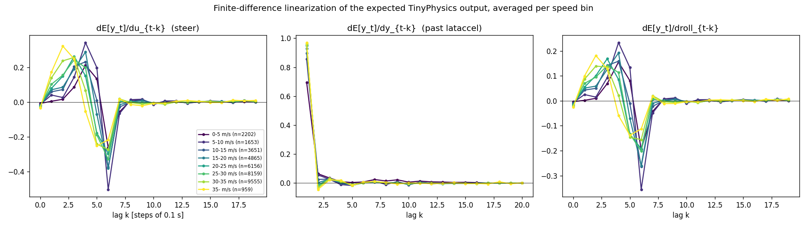

# System identification

Fit segments 15000-15299, held-out segments 15300-15399 (test set 00000-04999 not used).

## Fit error on held-out segments

RMSE in m/s^2. One-step = predict E[y_t] from the true past. Free-run = 20 steps (2 s) with the model's own outputs fed back, compared with the expected-value TinyPhysics run on the same inputs. Std of E[y] on held-out data: 0.483.

| model | one-step RMSE | 20-step free-run RMSE |
|---|---:|---:|
| ARX na=1 nb=8 nc=8 | 0.0441 | 0.1096 |
| ARX na=1 nb=8 nc=6 | 0.0441 | 0.1096 |
| ARX na=1 nb=10 nc=8 | 0.0439 | 0.1097 |
| ARX na=1 nb=7 nc=8 | 0.0441 | 0.1097 |
| ARX na=1 nb=10 nc=6 | 0.0440 | 0.1097 |
| ARX na=1 nb=7 nc=6 | 0.0441 | 0.1097 |
| ARX na=1 nb=6 nc=8 | 0.0442 | 0.1099 |
| ARX na=1 nb=6 nc=6 **(chosen)** | 0.0442 | 0.1099 |
| Jacobian linearization, 8 lags (only bias fitted) | 0.0518 | 0.2469 |
| hold last value (reference) | 0.0693 | 0.3041 |

Noise floor: RMSE between the full model's E[y_t] and the sampled y_t is 0.0456 (the simulator's own sampling noise).

## Chosen ARX per speed bin

| speed bin | n points | a (y lags) | b (u lags 0..nb) | c (roll lags) | d | dc gain u | dc gain roll |
|---|---:|---|---|---|---:|---:|---:|
| 0-5 m/s | 2202 | [0.972] | [0.045, 0.062, 0.008, 0.095, 0.163, 0.137, -0.463] | [0.016, -0.112, 0.214, -0.309, 1.068, -0.654, -0.193] | 0.008 | 1.631 | 1.096 |
| 5-10 m/s | 1653 | [0.968] | [-0.073, 0.189, 0.083, 0.172, 0.326, 0.124, -0.752] | [-0.609, 1.340, -0.991, 0.524, 0.364, -0.234, -0.356] | 0.011 | 2.126 | 1.206 |
| 10-15 m/s | 3651 | [0.932] | [-0.006, 0.148, 0.065, 0.172, 0.179, 0.024, -0.488] | [0.120, 0.166, -0.192, -0.044, 0.135, 0.300, -0.415] | 0.008 | 1.402 | 1.023 |
| 15-20 m/s | 4865 | [0.956] | [-0.034, 0.169, 0.056, 0.128, 0.256, -0.068, -0.441] | [0.010, -0.028, 0.218, 0.006, 0.121, -0.043, -0.242] | 0.006 | 1.502 | 0.966 |
| 20-25 m/s | 6156 | [0.954] | [-0.040, 0.185, 0.103, 0.231, 0.087, -0.203, -0.293] | [-0.084, 0.234, -0.013, 0.189, 0.034, -0.151, -0.163] | 0.003 | 1.535 | 0.982 |
| 25-30 m/s | 8159 | [0.951] | [-0.024, 0.196, 0.098, 0.185, 0.149, -0.225, -0.301] | [-0.081, 0.210, 0.155, -0.056, 0.076, -0.058, -0.197] | 0.002 | 1.571 | 0.988 |
| 30-35 m/s | 9555 | [0.948] | [-0.049, 0.251, 0.170, 0.205, 0.008, -0.267, -0.233] | [-0.134, 0.270, 0.131, 0.023, -0.055, 0.105, -0.289] | -0.000 | 1.646 | 0.997 |
| 35- m/s | 959 | [0.955] | [-0.059, 0.258, 0.269, 0.226, -0.130, -0.299, -0.180] | [-0.279, 0.755, -0.724, 0.794, -0.446, 0.315, -0.368] | -0.002 | 1.863 | 1.002 |

## Closed-loop re-identification (scripts/sysid_closed_loop.py)

The ARX above was fitted on PID+FF-like steering. Each round runs the MPC (+ dither) on the sysID segments and refits the same ARX order on all data so far. One-step / 20-step free-run RMSE on held-out segments of each regime, before and after the refit:

| round | held-out data | previous model | refit model |
|---|---|---|---|
| 1 | round0 (PID+FF) | 0.0442 / 0.1099 | 0.0496 / 0.1167 |
| 1 | round1 (MPC) | 0.0954 / 0.1428 | 0.0737 / 0.1330 |
| 2 | round0 (PID+FF) | 0.0496 / 0.1167 | 0.0492 / 0.1158 |
| 2 | round1 (MPC) | 0.0737 / 0.1330 | 0.0746 / 0.1326 |
| 2 | round2 (MPC) | 0.0574 / 0.1230 | 0.0563 / 0.1209 |

The MPC uses the round-1 models (`arx_models_round1.json`). In the dev grid (segments 10000-10199, results/tuning/mpc_sweep_10000-10199.json) the best round-1 setting scored 50.69 vs 52.04 for the best round-0 setting; round 1 was better on 9 of 18 identical settings. The gain is small: the best settings steer smoothly, where the round-0 model was already accurate.
