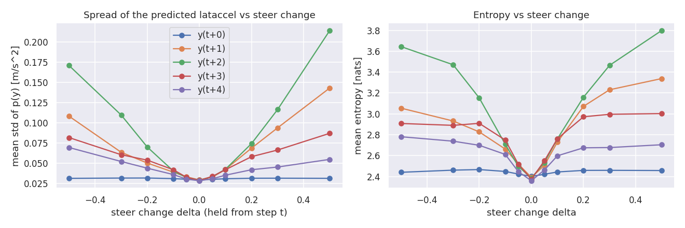

# Step 1: variance-aware control

Generated by `scripts/summarize_variance.py` from saved runs. Costs are the official total cost.

## 1a. Does the steer action change the spread of the predicted distribution?

10000 operating points from the final iLQR's closed-loop runs on dev 10000-10099 (iLQR closed loop). The past is held fixed; the steer from step t on is set to u_t + delta (held), intermediate lataccels are expected values. Std and entropy of p(y_{t+k}) over the 1024 bins.

| k | mean std at delta=0 | mean entropy at delta=0 | best variance reduction, abs(delta)<=0.1 (mean / median) | mean abs std change, abs(delta)<=0.1 | mean abs mean shift, abs(delta)<=0.1 | best variance reduction, abs(delta)<=0.3 |
|---:|---:|---:|---:|---:|---:|---:|
| 0 | 0.0298 | 2.401 | 2.1% / 0.0% | 0.0017 | 0.004 | 2.8% |
| 1 | 0.0295 | 2.392 | 2.5% / 0.0% | 0.0143 | 0.042 | 3.6% |
| 2 | 0.0293 | 2.384 | 2.5% / 0.0% | 0.0160 | 0.111 | 2.9% |
| 3 | 0.0290 | 2.374 | 2.8% / 0.0% | 0.0170 | 0.149 | 3.2% |
| 4 | 0.0285 | 2.359 | 3.8% / 0.0% | 0.0101 | 0.165 | 6.0% |

## 1b. Variance-aware controllers on dev 10000-10199

Reference: final iLQR on the same segments, total 36.858. Paired difference = mean over segments of (controller - iLQR), with its standard error.

| controller | lataccel | jerk | total | median | paired diff vs iLQR |
|---|---:|---:|---:|---:|---:|
| final iLQR (reference) | 0.397 | 16.985 | 36.858 | 36.98 | |
| risk-sensitive iLQR, variance weight 0.75 | 0.393 | 16.938 | 36.607 | 36.52 | -0.251 +- 0.130 |
| risk-sensitive iLQR, variance weight 1.5 (exact one-step expectation) | 0.393 | 16.859 | 36.516 | 36.41 | -0.342 +- 0.132 |
| risk-sensitive iLQR, variance weight 3 | 0.396 | 16.773 | 36.552 | 36.47 | -0.306 +- 0.199 |
| risk-sensitive iLQR, weight 1.5, steer-rate weight 1 (not 2) | 0.388 | 17.622 | 37.005 | 36.31 | +0.147 +- 0.193 |
| expected-cost lookahead, d = 0 (pure one-step) | 226.999 | 61.994 | 11411.943 | 4215.88 | +11375.085 +- 1292.247 |
| expected-cost lookahead, d = 3 (spans the delay) | 6.038 | 24.131 | 326.051 | 45.38 | +289.193 +- 132.787 |
| MPPI, iid perturbations, with variance term | 31.680 | 64.816 | 1648.792 | 182.01 | +1611.934 +- 338.186 |
| MPPI, iid perturbations, no variance term | 30.385 | 66.447 | 1585.704 | 171.37 | +1548.846 +- 385.666 |
| MPPI, ramp perturbations, 128 samples, 2 iterations, with variance term | 0.427 | 17.747 | 39.087 | 39.39 | +2.228 +- 0.242 |
| MPPI, ramp perturbations, 128 samples, 2 iterations, no variance term | 0.453 | 18.227 | 40.894 | 40.59 | +4.036 +- 0.352 |

## 1c. How much of the noise floor does it remove? (dev 10000-10099)

Deterministic plant = the token nearest the expected value instead of a random draw (analysis only).

| controller | stochastic (official) | deterministic | cost due to noise |
|---|---:|---:|---:|
| final iLQR | 36.842 | 12.664 | 24.177 |
| risk-sensitive iLQR (weight 1.5) | 36.657 | 12.776 | 23.881 |

Stochastic cost change: -0.185, i.e. 0.8% of the iLQR's noise cost (24.177) removed. Noise cost itself changes -0.296.

## Dev 500 and the single test run

| controller | segments | lataccel | jerk | total |
|---|---|---:|---:|---:|
| ilqr | 10000-10499 | 0.415 | 18.145 | 38.918 |
| ilqr_rs | 10000-10499 | 0.412 | 18.030 | 38.646 |
| ilqr | 00000-04999 | 0.438 | 18.707 | 40.587 |
| ilqr_rs | 00000-04999 | 0.433 | 18.563 | 40.231 |

dev 500: paired difference (risk-sensitive - iLQR) -0.272 +- 0.055, better on 296 of 500 segments.

test 5000: paired difference (risk-sensitive - iLQR) -0.356 +- 0.053, better on 3085 of 5000 segments.
